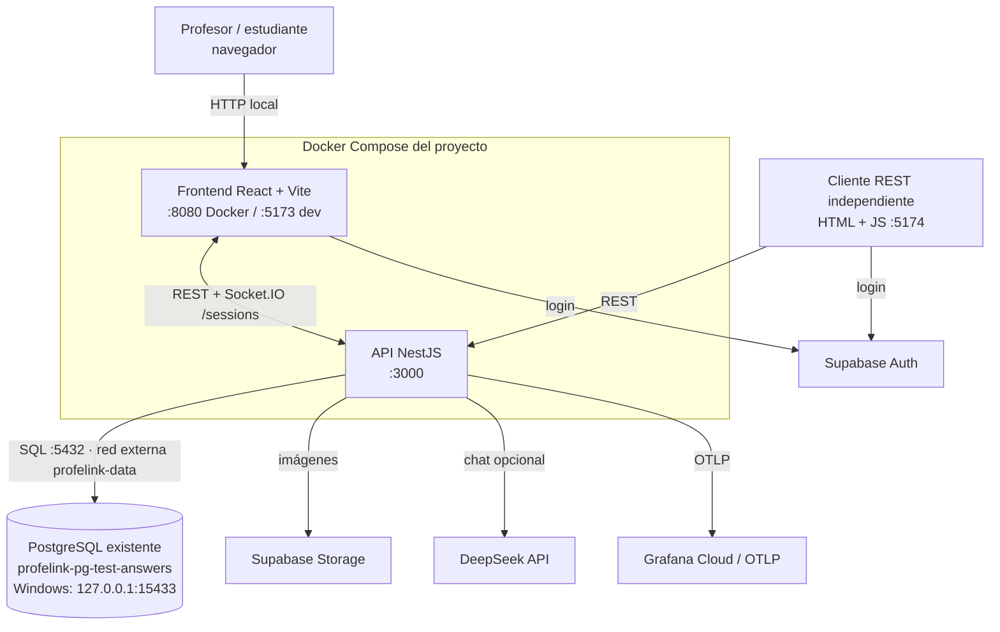
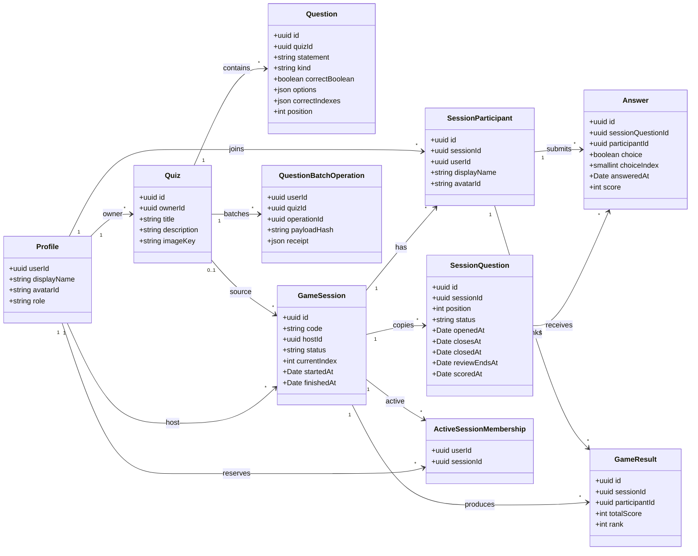
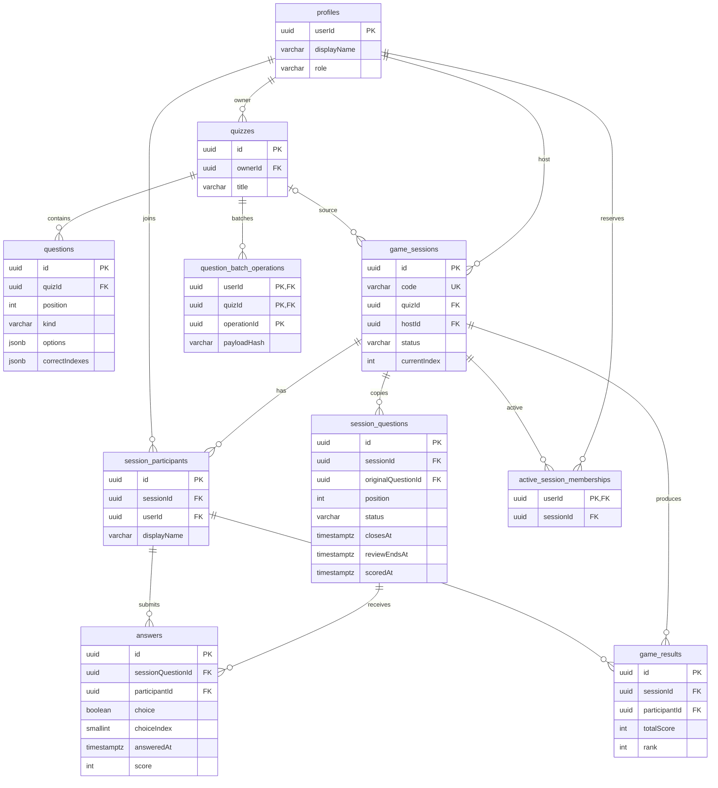

# Especificación breve — ProfeLink

## 1. Alcance

ProfeLink permite a un profesor autenticado crear cuestionarios, agregar preguntas de verdadero/falso o de cuatro opciones con una o varias respuestas válidas, abrir una sala y dirigir una partida en vivo. Los estudiantes se unen mediante un código de seis caracteres, reciben las preguntas por Socket.IO, responden antes del cierre y ven la revisión y la clasificación. El historial queda disponible para el anfitrión y para los participantes.

El proyecto incluye además un cliente REST independiente que consulta el estado de una sala sin usar Socket.IO.

## 2. Reglas de negocio observadas en el código

- Una sala tiene estados `WAITING`, `IN_PROGRESS` y `FINISHED`; una pregunta copiada tiene `PENDING`, `OPEN` y `CLOSED`.
- Solo el profesor propietario del cuestionario puede crear/editar/eliminar sus cuestionarios y dirigir la sala.
- El host no puede responder como participante.
- Un usuario puede tener una sola membresía activa (`active_session_memberships`); al finalizar se libera y el historial permanece.
- La duración de pregunta es 5–120 s (por defecto 30 s); la revisión es 3–15 s (por defecto 5 s).
- La pregunta se abre al iniciar/avanzar, registra `openedAt` y `closesAt`, y se cierra por plazo o cuando todos los participantes fijados tienen respuesta aceptada.
- Una respuesta se identifica por `(sessionQuestionId, participantId)`; es idempotente y una elección distinta produce un conflicto.
- La respuesta usa el timestamp de admisión del servidor; una respuesta admitida antes del cierre no se rechaza por esperar en cola.
- Puntuación al cerrar: incorrecta 0; correcta 1; el primer acierto rápido (dentro de 3 s) recibe 3; los aciertos consecutivos agregan el bono de racha (1 punto adicional por acierto previo consecutivo).
- La revisión y el avance/finalización son transiciones del servidor; finalizar manualmente es terminal para respuestas pendientes no confirmadas.
- Las preguntas se copian a `session_questions` al crear la sala, de modo que editar el cuestionario original no cambia una partida ya creada.
- La autenticación de API y Socket.IO se delega en Supabase Auth mediante JWT.

## 3. Arquitectura



Fuente editable: [`diagramas/arquitectura.mmd`](diagramas/arquitectura.mmd). Imagen: [`diagramas/arquitectura.png`](diagramas/arquitectura.png).

Componentes verificables:

- Frontend React 19 + Vite + React Router; cliente REST y Socket.IO.
- API NestJS 11 con TypeORM, guards JWT, filtros de sesión y gateway Socket.IO.
- PostgreSQL 17.11 en un contenedor **preexistente**; Compose no define un servicio `db`. La API usa DNS Docker `profelink-pg-test-answers:5432` en la red externa `profelink-data`; desde Windows se conserva `127.0.0.1:15433`.
- Supabase Auth para login/JWT y Supabase Storage para imágenes firmadas.
- DeepSeek es opcional para el chatbot del profesor; sin clave, el CRUD manual sigue funcionando.
- OpenTelemetry con exportador OTLP opcional (métricas de juego y métricas HTTP centralizadas).

## 4. Diagrama de clases principales



Fuente: [`diagramas/clases.mmd`](diagramas/clases.mmd). Imagen: [`diagramas/clases.png`](diagramas/clases.png).

## 5. Modelo de datos



Fuente: [`diagramas/modelo-datos.mmd`](diagramas/modelo-datos.mmd). Imagen: [`diagramas/modelo-datos.png`](diagramas/modelo-datos.png).

Tablas y restricciones destacadas:

| Tabla | Clave / restricción | Relación |
|---|---|---|
| `profiles` | PK `userId` | Propietario/host/jugador |
| `quizzes` | PK `id`, FK `ownerId` | `owner` → `profiles` |
| `questions` | PK `id`, unique `(quizId, position)` | `quiz` |
| `game_sessions` | PK `id`, unique `code`, checks de estado/tiempos | `quiz?`, `host` |
| `session_questions` | PK `id`, unique `(sessionId, position)` | copia de `questions`, `game_sessions` |
| `session_participants` | PK `id`, unique `(sessionId, userId)` | `game_sessions`, `profiles` |
| `answers` | PK `id`, unique `(sessionQuestionId, participantId)` | pregunta copiada y participante |
| `game_results` | PK `id`, unique `(sessionId, participantId)` | participante y sala |
| `active_session_memberships` | PK `userId`; FK a participante | reserva de sala activa |
| `question_batch_operations` | PK compuesta `(userId, quizId, operationId)` | idempotencia de lotes |

`synchronize` está desactivado: el esquema se crea con las migraciones existentes; la entrega no cambia migraciones ni datos.

## 6. API REST

La especificación generada está en [`evidencias/openapi.json`](evidencias/openapi.json) y en `http://localhost:3000/docs`. Los endpoints `/sessions/*` usan un formato de error `{ statusCode, code, message }`; el resto usa el formato estándar de NestJS.

| Método | Ruta | Auth | Propósito |
|---|---|---|---|
| GET | `/` | No | Mensaje de bienvenida |
| GET | `/health` | No | Salud de API y BD (`database:"up"`) |
| GET | `/auth/me` | Bearer | Usuario autenticado |
| GET | `/profiles/me` | Bearer | Perfil propio |
| PATCH | `/profiles/me` | Bearer | Actualizar nombre/avatar |
| GET | `/quizzes` | Bearer | Cuestionarios propios |
| POST | `/quizzes` | Bearer, profesor | Crear cuestionario |
| GET | `/quizzes/:id` | Bearer, propietario | Detalle y preguntas |
| PATCH | `/quizzes/:id` | Bearer, propietario | Editar cuestionario |
| DELETE | `/quizzes/:id` | Bearer, propietario | Eliminar cuestionario |
| POST | `/quizzes/:id/duplicate` | Bearer, propietario | Duplicar cuestionario |
| POST | `/quizzes/:quizId/questions` | Bearer, propietario | Agregar pregunta |
| PATCH | `/questions/:id` | Bearer, propietario | Editar pregunta |
| DELETE | `/questions/:id` | Bearer, propietario | Eliminar pregunta |
| PUT/DELETE | `/quizzes/:id/image` | Bearer, propietario | Imagen del cuestionario |
| PUT/DELETE | `/questions/:id/image` | Bearer, propietario | Imagen de pregunta |
| POST | `/quizzes/:quizId/questions/batch` | Bearer, propietario | Guardado idempotente por lote |
| POST | `/quizzes/:quizId/chat` | Bearer, profesor | Chatbot opcional |
| POST | `/sessions` | Bearer, profesor | Crear copia de sala |
| POST | `/sessions/join` | Bearer | Unirse/recuperar participación |
| GET | `/sessions/history` | Bearer, host | Historial del host |
| GET | `/sessions/played` | Bearer | Historial del participante |
| GET | `/sessions/:code/state` | Bearer, host/jugador | Estado por código |
| GET | `/sessions/:id` | Bearer, host/jugador | Estado por id |
| DELETE | `/sessions/:id/participants/me` | Bearer | Abandonar sala en espera |

Códigos de error de sesión: `UNAUTHORIZED`, `VALIDATION_ERROR`, `QUIZ_NOT_FOUND`, `SESSION_NOT_FOUND`, `HOST_REQUIRED`, `TEACHER_REQUIRED`, `HOST_CANNOT_PARTICIPATE`, `SESSION_ALREADY_STARTED`, `SESSION_FINISHED`, `SESSION_NOT_JOINABLE`, `SESSION_NOT_LEAVABLE`, `ALREADY_IN_ACTIVE_SESSION`, `QUESTION_NOT_CLOSED`, `QUESTION_NOT_OPEN`, `ANSWER_TOO_LATE`, `ANSWER_ALREADY_SUBMITTED`, `REVIEW_IN_PROGRESS`, `STALE_QUESTION`, `ROOM_CODE_UNAVAILABLE`, `INTERNAL_ERROR`. Los detalles están en `Back-Proyecto2/src/sessions/session.error.ts`.

## 7. Eventos en vivo (Socket.IO)

Namespace: `/sessions`. El JWT se valida en el handshake y el cliente no puede suplantar usuario/participante enviando IDs en el payload.

### Cliente → servidor

| Evento | Payload | Respuesta ack |
|---|---|---|
| `auth:refresh` | `{ token }` | datos de sesión o error |
| `room:join` | `{ code }` | `{ participant, room }` |
| `room:subscribe` | `{ sessionId }` | `RoomEnvelope` |
| `room:leave` | `{ sessionId }` | `{ sessionId }` |
| `game:start` | `{ sessionId }` | `RoomEnvelope` |
| `game:advance` | `{ sessionId, expectedQuestionId }` | `RoomEnvelope` |
| `game:finish` | `{ sessionId }` | `RoomEnvelope` |
| `answer:submit` | `{ sessionQuestionId, choice? , choiceIndex? }` | `{ answer: AnswerReceipt }` |

Ack común:

```json
{ "ok": true, "data": {} }
{ "ok": false, "error": { "code": "SESSION_NOT_FOUND", "message": "..." } }
```

`AnswerReceipt` contiene `id`, `sessionQuestionId`, `answeredAt` UTC y `choice` o `choiceIndex` según el tipo persistido.

### Servidor → clientes suscritos

| Evento | Payload | Propósito |
|---|---|---|
| `room:state` | `RoomEnvelope` | Snapshot público actualizado |
| `question:opened` | `RoomEnvelope` | Se abrió la pregunta |
| `question:closed` | `RoomEnvelope` | Cierre/revisión |
| `game:finished` | `RoomEnvelope` | Resultado final |
| `scoreboard:updated` | `RoomEnvelope` | Cambio de clasificación |

`RoomEnvelope` contiene `sessionId`, `streamId`, `sequence`, `serverTime`, `reviewDurationSeconds`, `scoreboard`, `remainingMs` y `state` (`SessionState`). El estado de una pregunta abierta no incluye la solución; la solución se incluye en `currentQuestion` solo cuando está `CLOSED`.

## 8. Seguridad y límites

- JWT de Supabase en `Authorization: Bearer` para REST y en el handshake para Socket.IO.
- Guards de autenticación/rol; pertenencia y propiedad se comprueban en el servicio/BD.
- Imágenes privadas servidas con URL firmada temporal; la service role nunca se envía al navegador.
- Telemetría HTTP con `http.route` normalizado; no se exportan URLs concretas, códigos de sala, JWT, cookies, emails, cuerpos ni SQL.
- El proyecto no incluye Redis, colas durables ni múltiples réplicas; la coordinación es local a una instancia.
- El modo real requiere Supabase; el modo mock es explícitamente simulado y no consulta servicios externos.
